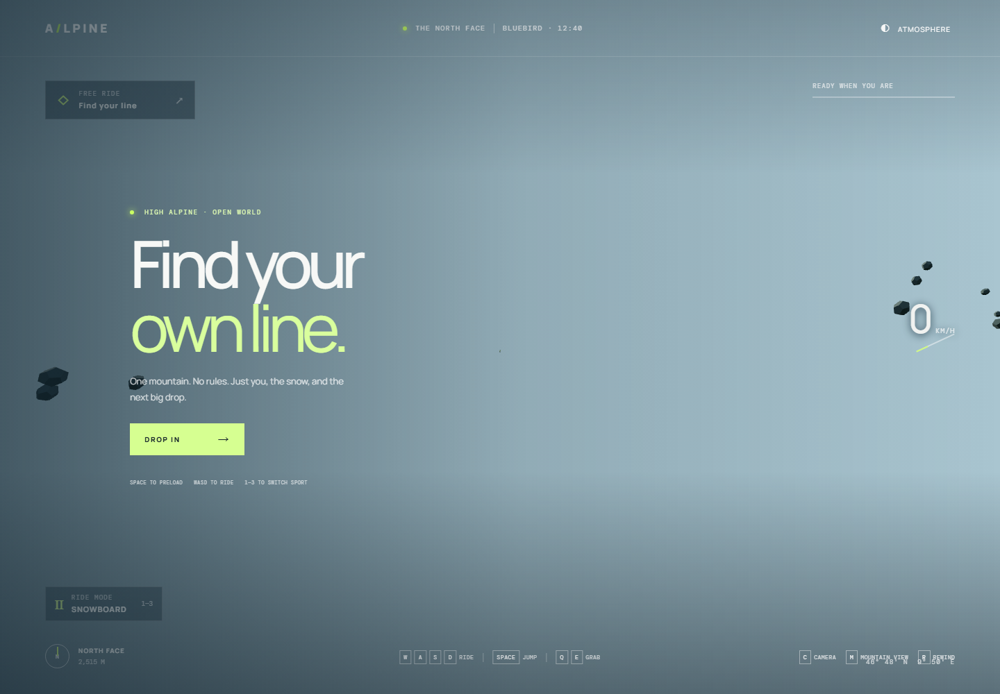
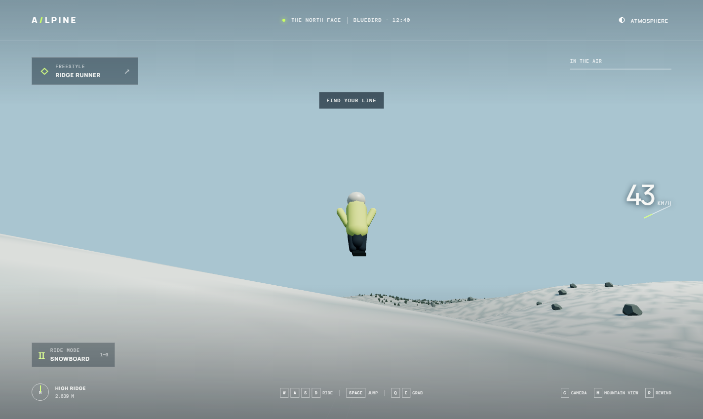
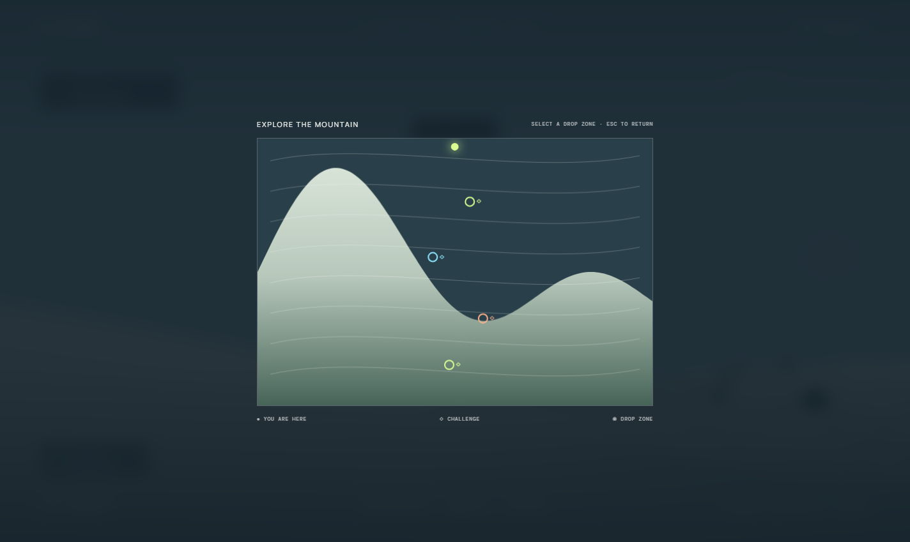

# steep — ride the wild

an original, browser-based alpine freeride game. carve down a sprawling procedural mountain on skis or a snowboard, or take flight in a wingsuit. chase your own line through open bowls, rocky ridges, pine forest, and glowing mountain challenges.

## screenshots

| the mountain | in the air |
|---|---|
|  |  |

### mountain view



## features

- **three ride styles** — responsive skis, flowing snowboard, and high-speed wingsuit with a deployable parachute
- **momentum-based riding** — carve, tuck, brake, preload jumps, spin, flip, and grab
- **trick and landing system** — build a combo in the air; stay aligned for a clean landing, or risk a wipeout
- **open alpine terrain** — a large procedural snow mountain with bowls, ridges, cliffs, rock fields, and lower-altitude pine forest
- **mountain exploration** — glowing race, freestyle, and wingsuit checkpoints; open the mountain view and click a drop zone
- **immersive presentation** — speed-reactive follow camera, helmet camera, carved snow tracks, snow spray, wind, and a minimal hud
- **changing conditions** — bright noon, golden hour, moonlight, and falling snow
- **generated audio** — ambient tones, mountain wind, and snow-cutting effects created locally in the browser

## run locally

install node.js 18 or newer, then run:

```sh
npm install
npm run dev
```

open the local url printed by vite (usually `http://localhost:5173`). build and preview the production version with:

```sh
npm run build
npm run preview
```

## controls

| input | action |
|---|---|
| `w` / `↑` | tuck for speed; pitch forward in the air |
| `a` / `d` / `←` / `→` | carve; spin while airborne |
| `s` / `↓` | brake; pitch back while airborne |
| hold and release `space` | preload, then jump |
| `q` / `e` or mouse buttons | grab while airborne |
| `1` / `2` / `3` | skis / snowboard / wingsuit |
| hold `tab` | sport radial |
| `space` in a wingsuit | deploy or stow parachute |
| `c` or `v` | follow camera / gopro view |
| `m` | mountain view; click to choose a drop zone |
| hold `r` | rewind to the ridge |
| `t` | cycle weather and time of day |
| `h` / `esc` | controls / close overlays |

wingsuits unlock in the air. find the glowing rings to discover challenges. the game and its audio run locally; no external game service or audio files are needed.

## license

this project is available under the mit license.
